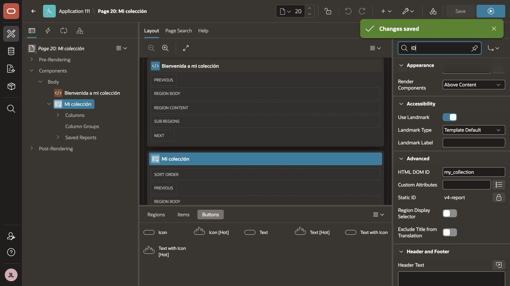
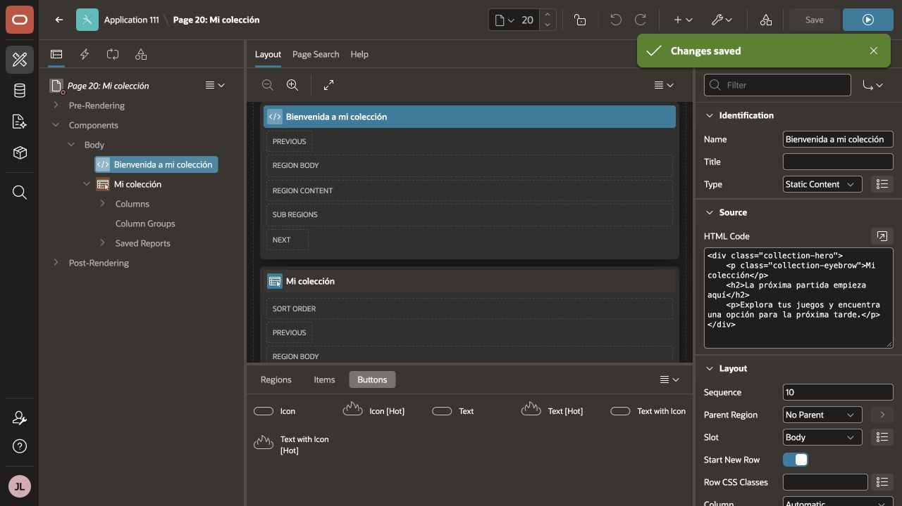
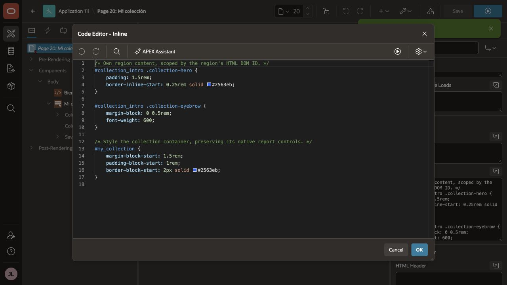

# HTML DOM ID: primeros ajustes de Mi colección

Material del artículo en preparación **HTML DOM ID en APEX: el Static ID que ya no era el que buscaba**.
Continúa [la selección múltiple](../seleccion-multiple-interactive-report/): la aplicación
incluye V0–V4 de NL2IR, Preparar propuesta y una nueva página 20, **Mi colección**.

El ejercicio asigna HTML DOM ID a una bienvenida y al contenedor del Interactive Report,
y aplica CSS propio sin sustituir sus controles. Conserva el modelo sintético del ejemplo:
no incorpora aún catálogo externo, estanterías por persona ni registro de partidas.

## Estado de validación

La página 20 está guardada en la app 111 local. Se han verificado propiedades, HTML/CSS,
consulta y conservación de las páginas anteriores; las capturas incluidas son de Builder.
La validación visual en ejecución, los filtros/NL2IR, teclado y tamaños siguen pendientes
porque no había sesión de ejecución disponible. No se declara ese recorrido probado.

## Requisitos

- Oracle APEX 26.1 y Universal Theme 26.1; el laboratorio utiliza el estilo Iris.
- Un workspace y esquema de laboratorio. Los datos de ejemplo son sintéticos.
- SQLcl 26.1 si se elige APEXlang; el SQL único también se importa desde App Builder.
- Un usuario APEX para entrar en la aplicación. No se incluyen usuarios ni contraseñas.
- Servicio IA propio sólo si se quiere probar NL2IR; los ajustes CSS y el informe funcionan
  sin hacer peticiones IA. La nueva región conserva la configuración NL2IR de V4.

## Instalar el ejemplo completo

1. Si empiezas desde cero, ejecuta [database/install.sql](database/install.sql), conectado al
   esquema de parsing. Instala los objetos de los ejercicios anteriores y carga los 28 juegos
   y las 32 partidas iniciales. No contiene un borrado del esquema.
2. Si ya tienes el ejemplo de selección múltiple en el mismo esquema, conserva sus objetos
   y datos: este artículo no añade DDL ni necesita volver a cargar el dataset. Ejecuta
   [database/verify.sql](database/verify.sql) para comprobar las tablas, vista y API requeridas.
3. Importa **una** de las dos representaciones de la aplicación. Para una instalación nueva,
   usa un ID libre generado por APEX; el ID de origen 111 no es una reserva para tu instancia.
   Un ID puede existir en otro workspace aunque no lo veas en el listado del tuyo.
   Para continuar una app existente, sigue primero la ruta incremental de abajo.
4. Abre **Mi colección** desde el menú lateral. La página es la 20 cualquiera
   que sea el ID elegido para la app.

### Alternativa A: SQL único

En App Builder → Import selecciona [application/sql/f111.sql](application/sql/f111.sql).
Elige workspace, esquema de parsing y el ID apropiado para tu ruta de instalación. El SQL es la exportación
de la aplicación; los objetos se instalan aparte en el paso 1 cuando hagan falta.

### Alternativa B: APEXlang

Desde esta carpeta, con SQLcl conectado al esquema de parsing:

```text
apex validate -input application/apexlang/a-que-jugamos -workspace TU_WORKSPACE
apex import -input application/apexlang/a-que-jugamos -workspace TU_WORKSPACE -schema TU_ESQUEMA -id ID_LIBRE -alias A-QUE-JUGAMOS
```

En una instalación nueva, elige otro alias si ya existe. No importes ambas alternativas sobre IDs distintos por error:
son dos formatos de la misma app. La exportación no instala los objetos automáticamente.

La configuración IA referencia un servicio y credencial sin secreto. En otro workspace,
asigna tu propio servicio/credencial antes de usar NL2IR. Para compartir tu instalación,
regenera su salt desde Shared Components → Security Attributes → Expire Bookmarks: la copia
pública neutraliza ese valor. No añadas claves al repositorio.

## Continuar la misma aplicación

El proyecto mantiene una única app, la **111**: cada artículo añade páginas y patrones sobre
ella. Si ya tienes la versión de selección múltiple, exporta un respaldo y sigue el montaje
manual de abajo dentro de esa misma app. No vuelvas a ejecutar install.sql.

También puedes importar el snapshot completo sobre **el mismo ID** después del respaldo,
si aceptas sustituir toda su definición por la versión de esta carpeta. Eso conserva las
páginas publicadas en este ejemplo, pero no incorpora tus cambios adicionales de Builder:
si los tienes, utiliza el montaje manual. La importación no borra tablas ni crea otra estantería.

## Recrear el ejercicio paso a paso en Builder

La aplicación descargable ya contiene el resultado. Para seguir el antes/después, añade
la página dentro de tu app existente, con respaldo previo, y sigue este orden:

1. En App Builder → Create Page → Create Page as Copy, elige Page in this application.
   Copia la página 7 **V4 · Columnas derivadas** a una página libre, por ejemplo 20. Llámala
   **Mi colección**, con alias MI-COLECCION. Conserva el IR, su consulta, columnas, metadatos,
   formatos y configuración de lenguaje natural.
2. Retira sólo de la página copiada los dos botones de navegación entre versiones.
   Conserva las páginas originales. La nueva página no es una sexta variante NL2IR.
3. Reutiliza la región **Static Content** copiada de V4: nombre **Bienvenida a mi colección**,
   Slot **Body**, secuencia 10. Cambia Hero por **Blank with Attributes**, que deja el encabezado
   al HTML propio. Si la renombraste en el asistente, no crees otra región igual.
4. En Advanced → HTML DOM ID escribe collection_intro, sin #. Conserva el Static ID que
   identifica al componente. Pega [snippets/intro.html](snippets/intro.html) como HTML.
5. Renombra la región IR a **Mi colección**, secuencia 20, y asigna my_collection en su
   HTML DOM ID. Conserva su plantilla **Interactive Report** y sus controles nativos.
6. Guarda y ejecuta antes de añadir CSS. Comprueba el título, el informe y la búsqueda.
7. En la página, CSS → Inline, añade [snippets/page.css](snippets/page.css). Guarda y ejecuta.
   La bienvenida obtiene espacio y línea lateral; el informe, separación y borde superior.
8. En el inspector del navegador comprueba un único elemento con id collection_intro y otro
   con id my_collection. El div interior usa clases: no repitas el ID de la región en su HTML.
9. Si no se creó al copiar la página, añade la entrada a la página 20 al menú lateral. Prueba filtros, paginación,
   refresh nativo, teclado y un ancho estrecho. Si la copia conserva IA, repite una pregunta V4.

El color azul es una decisión del ejemplo. Revisa su convivencia con el tema instalado.
Para reutilizar un acabado entre regiones, utiliza una clase propia en CSS Classes;
Static ID y HTML DOM ID tienen responsabilidades distintas en 26.1.

## Capturas de configuración







El Static ID heredado de V4 se conserva; HTML DOM ID proporciona el destino CSS nuevo.
Las imágenes muestran configuración real, no un antes/después de la pantalla en ejecución.

## Qué contiene esta entrega

| Ruta | Contenido |
| --- | --- |
| application/sql/f111.sql | Aplicación completa, formato SQL único. |
| application/apexlang/a-que-jugamos/ | La misma aplicación en APEXlang. |
| database/install.sql | Objetos y dataset completo del ejemplo anterior, sin cambios de dominio. |
| database/verify.sql | Comprobaciones de objetos y recuentos; no modifica datos. |
| snippets/ | HTML y CSS exactos utilizados por la página 20. |
| evidence/ | Capturas y resultado de las comprobaciones del laboratorio. |

La ampliación se ha construido y guardado desde Builder en la app 111. Al preparar el formato APEXlang público se elimina de la página nueva la
navegación entre etapas; en el archivo de página 8, el alias de exportación del Row Selector
pasa de A a P para evitar una colisión con GAME_ID que detectó el compilador. La definición de página 8 en la app local se conserva intacta. El alias de exportación no cambia la clave seleccionada ni su validación servidor.

Consulta la [licencia MIT](../LICENSE) del repositorio. Estado editorial: en preparación;
ni el artículo ni esta rama implican publicación o fusión aprobadas.
